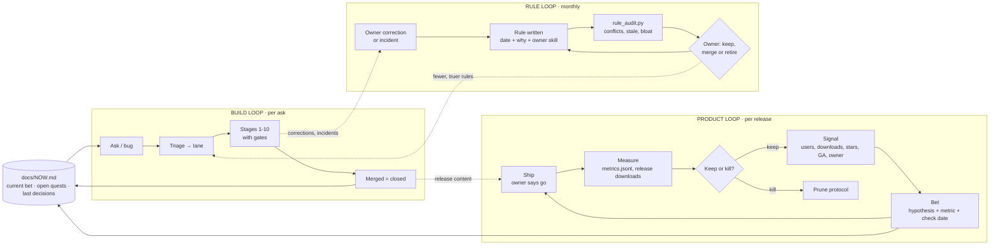
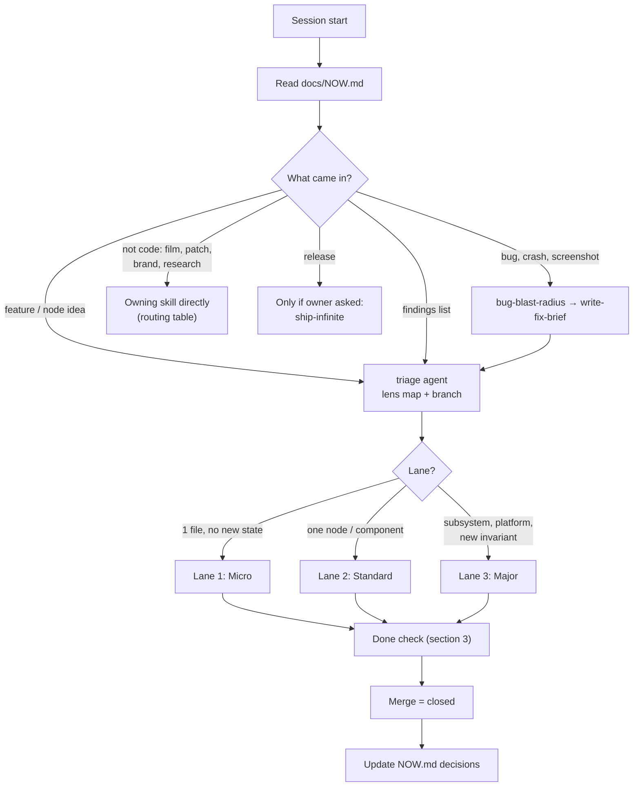
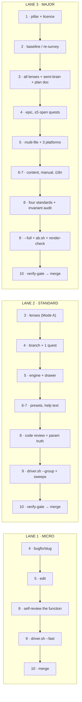
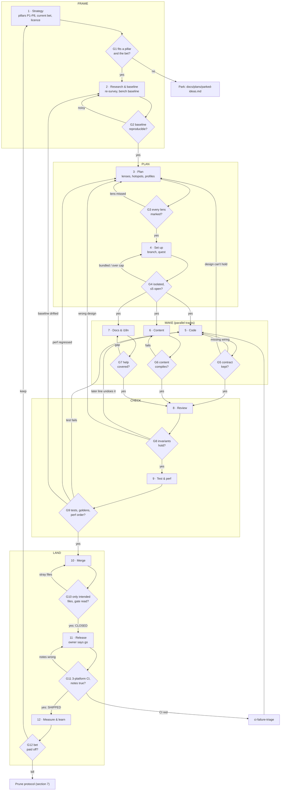
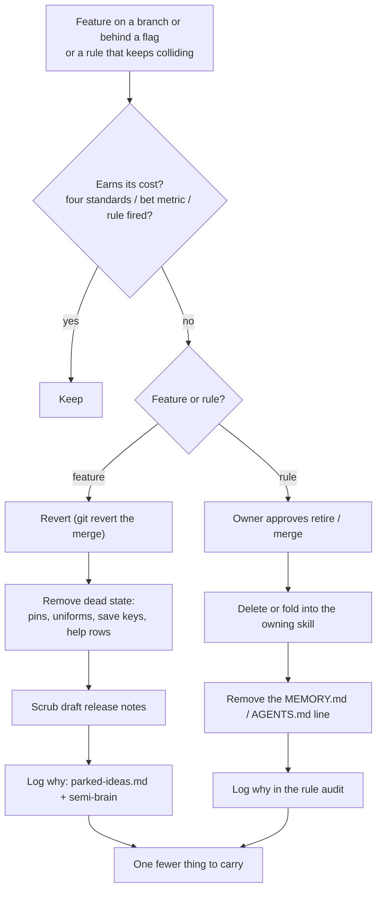

## When to use (full scope)

This is the **map, not the territory**. Each box names the skill that owns the detail; open that
skill for the how. If this file and an owning skill disagree on a detail, the owning skill wins and
this file gets fixed.

Read in this order:

1. `docs/NOW.md`: where we are (current bet, open quests, last decisions). Regenerate the facts
   with `python3 tools/lifecycle/now.py`.
2. The **routing table** (section 2): which lane and which skills.
3. The **gate table** (section 4) when something fails.

Paths are relative to the repo root.

---

## 1. The bird's-eye view: three loops around one page



| Loop | Question it answers | Cadence | Output |
|---|---|---|---|
| Product | Is the work moving income and reach? | Each release | Keep/kill on the current bet, a line in `NOW.md` |
| Build | Is this change correct, safe and finished? | Each ask | A merged branch (closed) |
| Rule | Are our rules still true, consistent and worth their words? | Monthly (and when two rules collide) | Retired or merged rules, smaller always-loaded context |

The build loop is the 12 stages below. The other two loops are what keep it pointed at the right
target (product) and keep it from growing without limit (rule).

---

## 2. Entry and routing



| Ask | Go to (in order) |
|---|---|
| Bug, crash, "this looks wrong" | `bug-blast-radius` → `write-fix-brief` → `triage` |
| New node | `triage` → `new-<kind>-node` → `infinite-planner` |
| Field source / preset | `field-language` → `field-pixel-presets` / `field-modifier-presets` |
| Node UI, widget, style | `node-ui-pillars` → `infinite-design-system` (→ `audio-node-ui` for audio) |
| Audio DSP or engine | `audio-pipeline-sweep` + `param-truth-audit` (+ `rhythmic-quantization-standard` for sync) |
| Timeline / arrange | `timeline-arrangement-architecture` |
| Platform code | `windows-parity` + `linux-parity` (+ `prior-art-scout` if the cause is outside our code) |
| Architecture choice | `semi-brain` → `codebase-lenses` → `infinite-planner` |
| Perf | `docs/plans/perf/README.md` → `run-infinite-hygiene` (efficient routes) |
| Patch (.inf) | `infinite-patch-authoring` |
| Film / video | `film-studio` (→ `motion-film` for Infinite films) |
| Brand surface | `docs/brand/BRAND.md` + `tools/brand/brand_lint.py` |
| Competitor study | `docs/plans/re-survey/README.md` |
| Red CI | `ci-failure-triage` |
| Release (owner asked) | `release-notes-audit` → `ship-infinite` |
| Repeating by-hand work | `tool-first` |

---

## 3. Lanes and their done checks



| Lane | Pick it when | Done when (all true) |
|---|---|---|
| 1 Micro | One file, no new state, no new param, no new invariant | Builds; `driver.sh --fast` passes; diff is only the intended files; merged |
| 2 Standard | One node, preset, panel or component | Lane 1 + `driver.sh --group <area>` and the area's sweep pass; help text and presets in; every new control has a `ParamRef` or a reason; saves and loads; `verify-gate` read |
| 3 Major | Subsystem, platform, threading, new invariant, new file format | Lane 2 + plan doc in `docs/plans/<x>/` closed; baseline A/B shows no regression on touched paths; builds on macOS, Windows, Linux; `invariant-interaction-audit` done; quest ledger linked |

**Not on any lane:** a release. Merged is *closed*; released is *shipped*, and only the owner
starts a release.

**Moving lanes:** if a Lane 1 fix turns out to need new state, a new param or a second file with
logic, stop and re-enter at Lane 2 stage 3. Never finish a grown task on the smaller lane.

---

## 4. The build loop: 12 stages, 12 gates



**Rule for every failure arrow:** go back to the stage that *owns* the failure, never further.
A failed test is a code problem (5) unless the test proves the design wrong (3). Nothing jumps
straight back to strategy except a finished bet (G12).

| # | Stage | Gate: pass when | On fail, go to | Owning skill / tool |
|---|---|---|---|---|
| 1 | Strategy | Maps to a pillar P1-P8 and to the current bet in `NOW.md`; no copyleft source read | Park in `parked-ideas.md` | `docs/plans/re-survey/README.md`, AGENTS invariant 1, `BRAND.md` |
| 2 | Research & baseline | Baseline repeats on a quiet machine | Re-run 2 | `run-infinite-hygiene` (efficient routes), `tools/re-survey/` |
| 3 | Plan | Every lens marked Primary / Touched / Clear, coupling rules applied | Re-open 3 | `codebase-lenses`, `codebase-navigation`, `semi-brain`, `infinite-planner` |
| 4 | Set up | One ask per branch; ≤5 open quests | Split the ask, or park a quest | `git-branch-workflow`, `tools/roadmap/` |
| 5 | Code | Two-object node split kept, `ParamRef`s registered, all three `Platform::` sides | 5; or 3 if the design can't hold | `new-*-node`, `field-*`, `windows-parity`, `linux-parity` |
| 6 | Content | Presets, templates and library build | 6 | `field-*-presets`, `tools/library/`, `tools/templates/` |
| 7 | Docs & i18n | Help text in all four tables, both directions; manual and fonts rebuilt if touched | 7 | `tools/manual/`, `tools/i18n/`, node-help-coverage rule |
| 8 | Review | Four standards met; no later line or sibling undoes the guarantee; knobs do what labels say | 5; or 3 if the design is wrong | `infinite-code-review`, `invariant-interaction-audit`, `param-truth-audit` |
| 9 | Test & perf | Driver tier for the lane passes; goldens match; touched perf paths no worse | 5 (fail), 3 (perf), 2 (baseline drift) | `run-infinite-hygiene`, `tools/render-check.py`, `scripts/bench/ab.sh` |
| 10 | Merge | `verify-gate` read; `git add` explicit paths only; merged to main = **closed** | Clean the diff | `git-branch-workflow`, `verify-gate` |
| 11 | Release | Owner asked; CI green on 3 platforms; notes match code = **shipped** | `ci-failure-triage` → 5; or fix notes | `ship-infinite`, `release-notes-audit` |
| 12 | Measure & learn | Bet's metric checked on its date; lessons logged | Keep → 1; kill → prune | `tools/roadmap/metrics.jsonl`, `semi-brain`, memory |

**Bugs are not a stage.** They enter at the front door (section 2), get the nine questions from
`bug-blast-radius`, and run a lane like any other ask. Every bug fix adds the regression test that
would have caught it (stage 9).

---

## 5. Operating profiles (what "good" means depends on where it runs)

| Profile | Clock | Priority order | Verified by |
|---|---|---|---|
| Live (stage, concert) | Real time | Audio > projector > canvas > previews | B1 heavy audio, B3 live performance (`docs/plans/perf/README.md`) |
| Studio (building a patch) | Real time, interactive | Audio and canvas > previews and meters > background | B5/B6 node-scaling and canvas benches |
| Offline (export, render) | Transport sample clock, not wall clock | Determinism and sync > quality > speed | `tools/render-check.py`, `tools/determinism-check.py`, `av-sync-sweep` |

Export quality is never traded for live speed. Stage 3 names the profile(s) a change touches;
stage 9 runs only that profile's checks.

---

## 6. Who decides what, and which rule wins

| The agent decides (and records it in `NOW.md` if it matters later) | The owner decides |
|---|---|
| Implementation, naming, file layout | Scope: what is in or out of the current bet |
| Which lane, which skills, which tests | Anything a user sees for the first time (new UI, new behaviour, wording on brand surfaces) |
| Design choices inside a plan doc (settle them, don't leave open questions) | Releases, pushes, tags |
| Splitting an ask into branches | Spending money, downloads that need a licence, accounts |
| Fixing a fact in a skill or doc | Retiring or merging a rule (rule loop) |
| Parking a quest over the cap | Deleting work: branches with unmerged commits, assets, media |

When the agent needs an owner decision: **one decision per message**, with a recommended
answer, and record the answer in `NOW.md` so it is never asked again.

**Precedence when two instructions disagree** (highest first):

1. Safety rules, and the owner's instruction in the current chat
2. AGENTS.md core invariants (clean room, bare names, three platforms, brand book)
3. The skill that owns the topic (AGENTS.md table)
4. This lifecycle map
5. Memory notes (newer beats older only when it says it supersedes; otherwise it's a conflict for the rule loop)
6. Plan docs and briefs

A collision you notice is itself an input: note it under "Rule conflicts" in `NOW.md` and let the
monthly audit settle it.

---

## 7. Pruning: features and rules



Real prunings from history, for calibration: Gaussian Splat node (`a764094f`, later
`1a46bca4`), Mod Mixer node (`3344b8d3`), node dropdown chevron (`d8f54bcb`), canvas zoom LOD
collapse (`5daa264b`, later undone), Tabler strokes replaced by our own glyphs (`ce2efd11`).
Not every trial dies: the video decode thread was removed and later reapplied (`db35579d`).

---

## 8. The product loop in practice

Each bet is one card in `NOW.md`:

| Field | Example shape |
|---|---|
| Bet | "Basics tutorials raise downloads per release" |
| Goal | Reach → income (`NOW.md` success order) |
| Metric | Downloads of the next release vs the last three |
| Check on | A date, or "release + 14 days" |
| Kill if | No change by the check date |

After each release (stage 12): run `python3 tools/lifecycle/now.py`, read the downloads and GA
lines it prints, and write keep or kill on the card. Changing the bet is an owner decision.

---

## 9. The rule loop in practice

```bash
python3 tools/lifecycle/rule_audit.py --memory ~/.claude/projects/-Users-namansoni-infinte/memory
```

It lists: always-loaded word count, skills missing from the AGENTS.md table (and table rows with
no skill), memories with no **Why:**, broken `[[links]]`, "supersedes" chains, and the largest and
oldest rules. The agent brings the top five to the owner, one at a time; the owner keeps, merges or
retires each. A new rule should name its owning skill and the incident behind it, or it doesn't get
written.

---

## 10. Cadence

| When | Do |
|---|---|
| Session start | Read `NOW.md`; regenerate it if older than a day |
| Each ask | Route (section 2) → lane → done check |
| Each merge | Update `NOW.md` decisions if a decision was made; quest closes via the ledger |
| Each release (owner calls it) | Stage 11, then stage 12 on the current bet |
| Monthly, or on a collision | Rule audit (section 9) |

Architecture diagrams (layers, threads, dataflow, the two-object node) live in
`docs/ARCHITECTURE_FLOWS.md`, not here.
