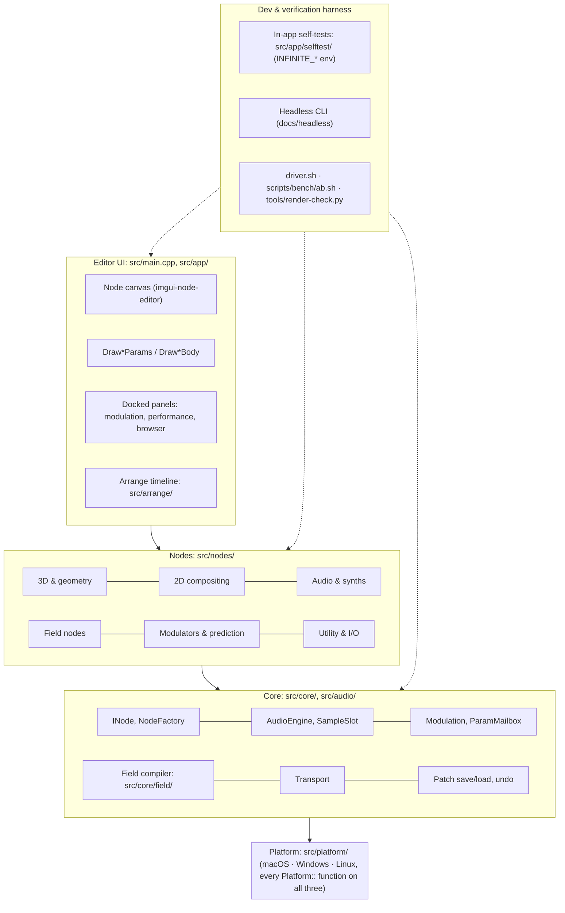
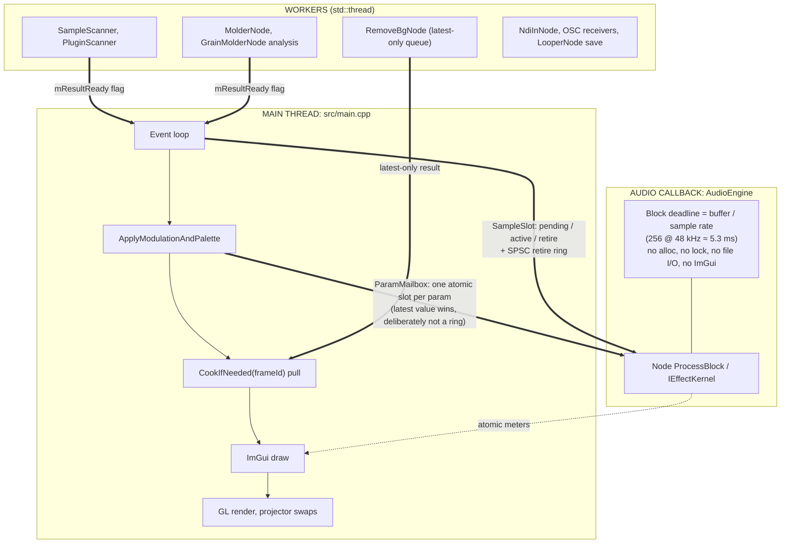
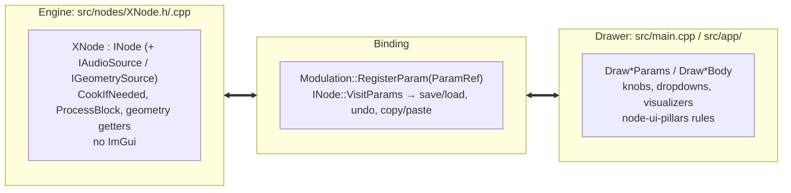

# Architecture flows

Diagrams of how Infinite's code is layered, threaded and cooked. The text map with symbols to
grep is [`ARCHITECTURE.md`](../ARCHITECTURE.md); that file wins on any detail. Labels here name
real symbols (checked 2026-10-12); if one stops existing, fix the label.

## 1. Layers

## 2. Threads and how they hand off

## 3. Data flow per frame

```mermaid
flowchart TD
    subgraph Push["MODULATION (push, main thread, once per frame)"]
        T["Transport tick"] --> Mod["Evaluate modulators"] --> Mx["Matrix: source × depth → ParamRef"]
        Mx --> UI["Main-thread params"]
        Mx --> MB["ParamMailbox → audio thread"]
    end
    subgraph Pull["VISUALS (pull, main thread)"]
        Out["Output / viewport / projector"] --> C["CookIfNeeded(frameId)"]
        C --> Same{"Already cooked<br/>this frame?"}
        Same -- yes --> Cached["Reuse texture"]
        Same -- no --> Up["Inputs' CookIfNeeded"] --> Rev{"Input revision<br/>moved?"}
        Rev -- yes --> Re["Recompute"]
        Rev -- no --> Keep["Reuse cache"]
    end
    subgraph APull["AUDIO (pull, audio thread, per block)"]
        CB["Device callback"] --> Pop["Read ParamMailbox slots"] --> Graph["Pull inputs along audio cables"] --> DSP["DSP"] --> HW["Device out"]
    end
```

## 4. The two-object node

