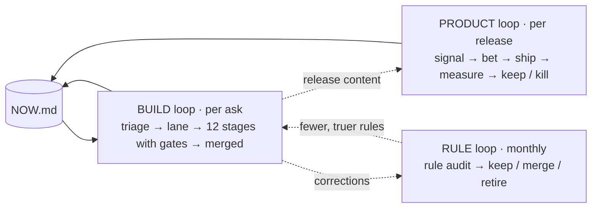

# How work moves through Infinite

The full map lives in one place: [`.claude/skills/infinite-lifecycle/SKILL.md`](../.claude/skills/infinite-lifecycle/SKILL.md).
This page is the short version for people. Where we are right now: [`docs/NOW.md`](NOW.md).

## Three loops around one page



- **Product** keeps the work aimed at income and reach.
- **Build** keeps each change correct, safe and finished.
- **Rule** keeps the rules few and true, so the process doesn't grow forever.

## The build loop at a glance

| Phase | Stages | Done means |
|---|---|---|
| Frame | 1 Strategy · 2 Research & baseline | Fits a pillar and the current bet; baseline repeats |
| Plan | 3 Plan · 4 Set up | Every concern lens marked; one branch, ≤5 open quests |
| Make | 5 Code · 6 Content · 7 Docs & i18n | Contracts kept on 3 platforms; presets compile; help covered |
| Check | 8 Review · 9 Test & perf | Invariants hold; tests, goldens and perf order pass |
| Land | 10 Merge · 11 Release · 12 Measure | Merged = closed; released (owner's call) = shipped; bet checked |

Small fixes skip the frame and most of the plan (Lane 1); a new node runs most stages (Lane 2);
subsystems run all of them (Lane 3).

## Tools

```bash
python3 tools/lifecycle/now.py
```

```bash
python3 tools/lifecycle/rule_audit.py --memory ~/.claude/projects/-Users-namansoni-infinte/memory
```

Architecture diagrams: [`ARCHITECTURE_FLOWS.md`](ARCHITECTURE_FLOWS.md).
